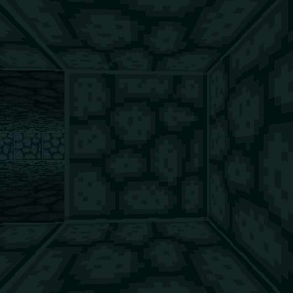
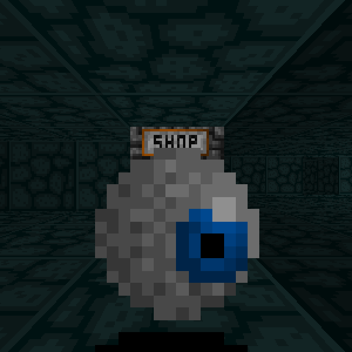
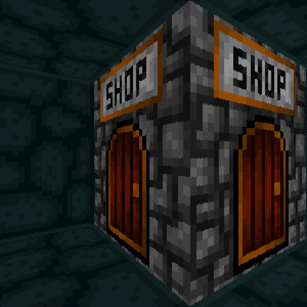
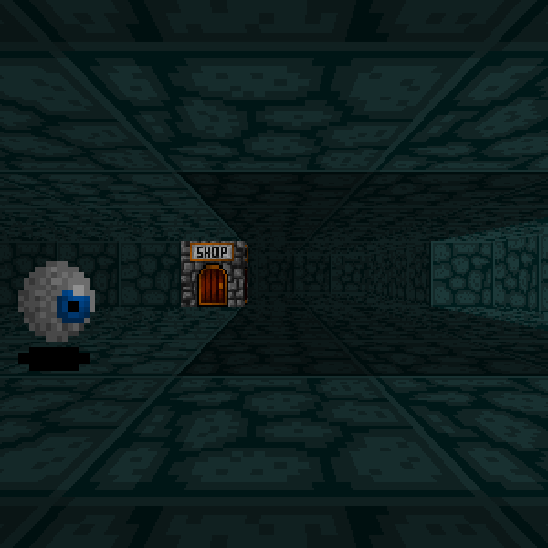
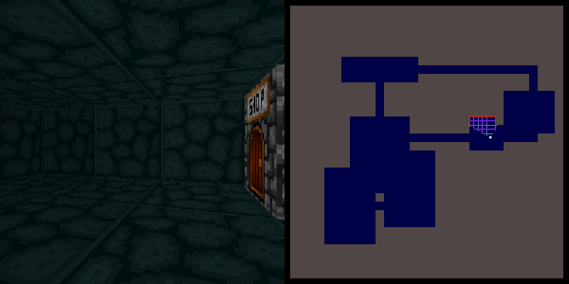

# FPRL Engine

A first-person roguelike engine written from scratch in C++. It is a software
renderer: every pixel is computed on the CPU and written to a framebuffer, and
SDL2 is only used to open a window, read the keyboard and show the finished
frame.

<p align="center">
  
</p>

## Features

- **Textured raycasting**: walls, floors and ceilings, with perspective-correct texture mapping
- **Random dungeons**: rooms joined by corridors, different on every run
- **Monsters as flat, directional sprites** that stand inside a tile and are found by the same ray that finds the wall
- **Per-tile lighting** using 64 precomputed darkness levels for each texture
- **Grid-based movement** with eight directions, smooth easing between tiles and collision detection
- **Debug view** that draws the map and every ray from above
- **Own BMP loader** for 4-bit and 8-bit palettes, including transparency
- **Own vector and matrix math**. SDL2 is the only dependency

<table>
  <tr>
    <td></td>
    <td></td>
    <td></td>
  </tr>
</table>

## How it works

<p align="center">
  
</p>
<p align="center"><em>The 3D view (left) and the debug view (right) at the same moment. Each dot is a point where a ray was tested.</em></p>

1. **Cast one ray per screen column.** [`Dda.h`](src/Dda.h) steps the ray through
   the map with a digital differential analyzer (DDA), jumping from grid line to
   grid line. It steps in *half* tiles: whole-tile lines are tested for walls, and
   the lines through the middle of a tile are tested for monsters. One pass
   therefore finds both the wall and the nearest monster.
2. **Project the distance.** The hit distance is measured along the viewing
   direction rather than along the ray, which avoids the fisheye effect.
3. **Draw floors and ceilings.** [`Renderer3D.h`](src/Renderer3D.h) runs the
   projection backwards, from screen row to map position, only for the pixels
   that the wall does not cover. Floor and ceiling are drawn in the same step.
4. **Draw walls, then monsters.** Each column is a vertical strip of the texture,
   scaled by distance. Transparent monster pixels are skipped.
5. **Light it.** [`Texture.h`](src/Texture.h) stores each texture at 64 darkness
   levels, so lighting a pixel at run time is just a lookup.

Game logic runs in ticks, targeting 60 per second, and frames are rendered
in between.

## Build and run

You need `g++`, `make` and SDL2.

```sh
sudo apt install g++ make libsdl2-dev   # Debian / Ubuntu
make
./RPG
```

Run it from the root of the repository, since assets are loaded by relative path.

## Controls

| Key | Action |
| --- | --- |
| `K` / `J` | Move forward / backward |
| `H` / `L` | Step left / right |
| `Q` / `E` | Turn left / right by 45° |
| `D` (hold) | Debug view |
| `Esc` | Quit |

## Code overview

| File | Purpose |
| --- | --- |
| [`App.cc`](src/App.cc) | Main loop, ticks and input |
| [`Renderer3D.h`](src/Renderer3D.h) | 3D view and debug view |
| [`Dda.h`](src/Dda.h) | Ray traversal |
| [`Map.h`](src/Map.h), [`Map.cc`](src/Map.cc) | Map data and dungeon generation |
| [`Being.h`](src/Being.h) | Player and monsters: movement, rotation, collision |
| [`Texture.h`](src/Texture.h) | BMP loading and darkness levels |
| [`FrameBuffer.h`](src/FrameBuffer.h), [`SDLWindow.h`](src/SDLWindow.h) | Pixel buffer and its SDL2 window |
| [`Vec2D.h`](src/Vec2D.h), [`Mat2D.h`](src/Mat2D.h), [`FixedDir.h`](src/FixedDir.h) | Math and compass directions |

## Credits

- Dungeon tiles: [RLTiles](http://rltiles.sf.net), public domain
- Monster sprite: the RLTiles floating eye, cropped to 20×20 (stored as `assets/wee/bmps/gobwar.bmp`)
